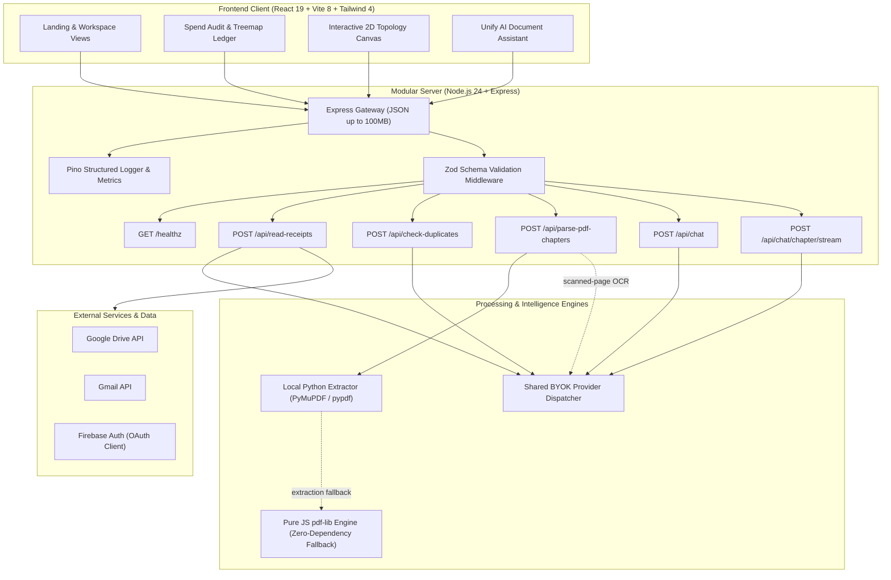

# Openedup — Spend Audit & Document Intelligence Platform

[](https://github.com/Lokeshgandreddy81/OpenedUP/actions/workflows/ci.yml)
[](https://github.com/Lokeshgandreddy81/OpenedUP/actions/workflows/security.yml)
[](https://www.typescriptlang.org/)
[](https://nodejs.org/)
[](LICENSE)

Document intelligence, spend reconciliation, and AI chat platform for receipt auditing, PDF analysis, and conversational workflows.

---

## Architecture Overview

The current HTTP API contract is maintained in [OpenAPI](packages/docs/api/openapi.yaml). Chat sessions use client-selected BYOK keys encrypted with AES-256-GCM at rest, with zero fallback to server environment secrets.

Provider model provenance, capability limits, and adapter support status live in the [BYOK catalog and adapter guide](specs/byok-catalog-adapters/README.md).



---

## Monorepo Layout

The repository is structured into four focused top-level directories:

```text
.
├── frontend/                       # React 19 + Vite browser application
│   ├── src/app/                    # Shell, routing, auth and shared integrations
│   ├── src/features/               # Feature-owned pages, UI, state, services and data
│   │   ├── artifacts/              # Artifact screen and persistence client
│   │   ├── benchmarks/             # Benchmarks, image arena and coding-agent screens
│   │   ├── chapters/               # Intake, document and results screens
│   │   ├── chat/                   # Chat screen, session UI and chat orchestration
│   │   ├── customize/              # Provider/model settings and key client
│   │   ├── plugins/                # Plugin catalog and install state
│   │   ├── projects/               # Projects, sessions and file context
│   │   ├── roadmaps/               # Roadmap screens, renderer and catalog data
│   │   └── scheduled/              # Scheduled task screens and UI
│   ├── src/                        # Feature code and colocated unit tests
│   └── infra/docker/               # Frontend Nginx configuration
├── backend/                        # Single-process modular Express application
│   ├── src/app.ts                  # Middleware and domain composition root
│   ├── src/domains/                # HTTP, application, provider and repository modules
│   ├── src/platform/               # Auth, config, database, HTTP and observability
│   └── src/                        # Backend domains and colocated unit tests
├── python/                         # Scalable Python document processing and chunking
│   ├── src/                        # PDF chapter extractor & roadmap generator
│   ├── pyproject.toml              # Ruff configuration
│   └── requirements.txt            # Python dependencies
├── packages/                       # Shared packages, configurations and documentation
│   ├── contracts/                  # Runtime-neutral schemas, types and helpers
│   └── docs/                       # Architecture decisions and OpenAPI contract
├── .github/                        # CI and repository configuration
├── docker-compose.yml              # Local multi-container orchestration
└── package.json                    # npm workspace orchestration
```

Each route/screen belongs to one feature and has its own `.tsx` page entry. Shared API schemas and models are defined in `@charan-interiors/contracts` (`packages/contracts/`) so that the frontend remains decoupled from backend runtime code.
---

## Quickstart

### Prerequisites

- **Node.js**: `v24.12.0+` (see `.nvmrc`)
- **npm**: `v10.9.0+`
- **Python**: `3.9+` (for local standalone PDF chapter extraction)

### Installation

Use Node.js `24.12.0` or newer and npm `10` or newer. The repository pins the tested Node version in `.nvmrc`; npm rejects versions outside the declared engine range. Then clone and install:

```bash
git clone git@github.com:Lokeshgandreddy81/OpenedUP.git
cd OpenedUP
npm ci
```

### Local Development

No environment file is required to start the app locally. Run both services from the repository root:

```bash
npm run dev
```

Open <http://localhost:5173>. Vite proxies `/api` requests to the backend at `http://localhost:3000`. Chat and scanned-PDF OCR use the selected provider model and its configured BYOK credential. Searchable PDFs are extracted locally first; scanned PDFs need a verified image-capable model and are limited to eight rendered pages per OCR request. `frontend/.env.example` is only needed if you want to override the Vite API proxy target.

### Docker Compose

Compose uses the root `.env` file (separate from `backend/.env`):

```bash
cp .env.example .env
docker compose up --build
```

Open <http://localhost:8080>. Before using signed-in credential storage, set `FIREBASE_PROJECT_ID` to match `frontend/firebase-applet-config.json` and set a stable, randomly generated, base64-encoded 32-byte `BYOK_ENCRYPTION_KEY` in `.env`. Scanned-PDF OCR uses the selected provider model and its BYOK credential. Keep the `openedup-data` volume to preserve stored account data. Do not commit populated `.env` files.

| Variable              | Required                  | Description                                                                      |
| :-------------------- | :------------------------ | :------------------------------------------------------------------------------- |
| `PORT`                | Optional                  | Backend HTTP port; defaults to `3000`.                                           |
| `FIREBASE_PROJECT_ID` | Optional                  | Firebase project used to verify signed-in users and protect saved provider keys. |
| `BYOK_ENCRYPTION_KEY` | For saved keys in Compose | Base64-encoded 32-byte key used to encrypt saved provider credentials.           |

---

---

## Skills Feature Architecture & Execution Model

The Skills system equips Claude and conversational models with modular domain expertise, automated tool harnesses, and isolated computational sandboxes without expanding baseline context windows.

### Architecture Diagram (Text)

```text
+---------------------------------------------------------------------------------------------------+
|                                        BROWSER / CLIENT                                           |
|                                                                                                   |
|   +--------------------------+   +----------------------------+   +---------------------------+   |
|   |   Chat Composer "+" Menu |   | Customize > Skills Market  |   |    Skill Creator Studio   |   |
|   |  - Explicit skill toggle |   |  - Claude-style Directory  |   |  - Live validation & test |   |
|   |  - Project-inherited tag |   |  - Contents / Agent viewer |   |  - Markdown & extra files |   |
|   +------------+-------------+   +--------------+-------------+   +-------------+-------------+   |
+----------------|--------------------------------|-------------------------------|-----------------+
                 |                                |                               |
                 v                                v                               v
+---------------------------------------------------------------------------------------------------+
|                                    BACKEND REST & TOOL LOOP                                       |
|                                                                                                   |
|  [getRequestIdentity]  <--- Identity Seam (auth decoupled: DEV_USER_ID, DEV_ORG_ID, DEV_ROLE)   |
|                                                                                                   |
|  [Skill Registry API]   -->  Validation (Zod, path traversal, zip bombs, binary checks)          |
|                         -->  Immutable Storage (SHA-256 manifest verification per file)           |
|                         -->  Approval Workflow (draft -> pending_review -> approved | rejected)   |
|                                                                                                   |
|  [Anthropic Tool Loop]                                                                            |
|     |                                                                                             |
|     +--> Turn 0: Synthetic Preload (for explicitly selected skills, loaded once)                 |
|     +--> Turn 1: System Prompt (<available_skills> progressive metadata)                          |
|     +--> Model decides: Invokes `Skill` tool (loads full SKILL.md body on demand)                 |
|     +--> Model executes: `Bash`, `Read`, `Write`, `SendUserFile` inside Sandbox                   |
+---------------------------------------------------------------------------------------------------+
                                                  |
                                                  v
+---------------------------------------------------------------------------------------------------+
|                                      SANDBOX ISOLATION LAYER                                      |
|                                                                                                   |
|  Interface: SandboxExecutor                                                                       |
|                                                                                                   |
|  +-------------------------------------------------+  +----------------------------------------+  |
|  | DockerSandboxExecutor (Production)              |  | UnsafeLocalSandboxExecutor (Dev Only)  |  |
|  | - Non-root execution (UID 1000:1000)            |  | - STRICT GUARD: SANDBOX_MODE=          |  |
|  | - Read-only root filesystem                     |  |   unsafe-local AND NODE_ENV=dev/test   |  |
|  | - Read-only skills mount (/mnt/skills/)         |  | - Strips all server env vars & tokens  |  |
|  | - Dedicated writable workspace (/work)          |  | - Blocks host file traversals & .env   |  |
|  | - Network isolated (--network none)             |  | - Process group termination on timeout |  |
|  | - Per-command timeout & CPU/RAM/PID limits      |  | - Symlink escape protection (lstat)    |  |
|  +-------------------------------------------------+  +----------------------------------------+  |
+---------------------------------------------------------------------------------------------------+
```

### The Three Progressive Loading Levels

Skills use a 3-tier progressive context-loading model to minimize token consumption and avoid context bloat:

1. **Level 1: System Prompt Registration (`<available_skills>`)**
   - At session start, enabled skills contribute only lightweight XML metadata (`name` and `description`) into the system prompt.
   - Cost: ~30-50 tokens per skill.
   - For auto-matched skills, the model evaluates whether the user's task warrants calling the skill.

2. **Level 2: On-Demand Instruction Retrieval (`Skill` Tool Call or Explicit Pre-load)**
   - When the task matches an auto-matched skill, the model invokes the `Skill` tool with `{ "skill": "<name>" }`.
   - For skills **explicitly enabled via the composer "+" menu**, the system automatically synthesizes a `Skill` tool_use/tool_result pair on the next turn, force-loading `SKILL.md` exactly once without requiring the model to decide.
   - Cost: full `SKILL.md` body loaded only when needed.

3. **Level 3: Isolated Execution (`Bash`, `Read`, `Write`)**
   - The loaded instructions guide the model to run scripts or template generators located under `/mnt/skills/{scope}/{name}/scripts/`.
   - Tool execution is isolated inside the per-conversation sandbox workspace, and user attachments are returned via `SendUserFile`.

---

### Sandbox Isolation Model

- **Docker Implementation (`DockerSandboxExecutor`)**:
  - Container-per-conversation or isolated transient container.
  - Read-only root filesystem (`--read-only`).
  - Read-only skill mounts at `/mnt/skills/{scope}/{name}/:ro`.
  - Dedicated writable scratch directory at `/work`.
  - Zero network access by default (`--network none`).
  - Strict resource constraints (`--memory=512m`, `--cpus=1.0`, `--pids-limit=64`).
  - Hard execution timeout (default 60s) with process group termination.
- **Local Fallback (`UnsafeLocalSandboxExecutor`)**:
  - Strictly blocked in production. Requires both `SANDBOX_MODE=unsafe-local` and `NODE_ENV !== 'production'`.
  - Host environment variable stripping (zero inheritance of host secrets, tokens, or database URLs).
  - Strict path traversal barriers and symlink resolution guards (`fs.lstatSync`).
  - Ephemeral sandbox directory cleanup with TTL janitor.

---

### Configuration & Environment Variables

| Variable                            | Default                   | Description                                                     |
| :---------------------------------- | :------------------------ | :-------------------------------------------------------------- |
| `SANDBOX_MODE`                      | `docker`                  | Sandbox runner: `docker` or `unsafe-local` (dev/test only).     |
| `SANDBOX_IMAGE`                     | `openedup-sandbox:latest` | Docker base image for sandboxed tool execution.                 |
| `DEV_USER_ID`                       | `dev-user`                | Identity seam: mock user ID when auth is decoupled in dev.      |
| `DEV_ORG_ID`                        | `dev-org`                 | Identity seam: mock org ID when auth is decoupled in dev.       |
| `DEV_ROLE`                          | `user`                    | Identity seam: mock role (`user` or `admin`) in dev.            |
| `SKILL_UPLOADS_PER_HOUR`            | `30`                      | Max skill package uploads per hour per user/IP.                 |
| `SKILL_TOOL_CALLS_PER_CONV_PER_MIN` | `20`                      | Max `Skill` tool instruction loads per minute per conversation. |
| `BASH_CALLS_PER_CONV_PER_MIN`       | `30`                      | Max `Bash` tool calls per minute per conversation.              |
| `USER_DAILY_SANDBOX_CPU_SECONDS`    | `300`                     | Max cumulative daily sandbox CPU-seconds per user.              |
| `ANTHROPIC_API_KEY`                 | _(None)_                  | Optional Anthropic key for live end-to-end tool loop tests.     |

---

### BEFORE PRODUCTION Checklist

Before promoting the application to production:

- [ ] **1. Restore Real Auth via `getRequestIdentity`**:
  - Replace the development identity bypass in `backend/src/platform/auth/identity.ts` with real JWT verification / session decoding.
  - In production (`NODE_ENV === 'production'`), `getRequestIdentity` will automatically throw if dev fallback is attempted.
- [ ] **2. Disable `unsafe-local` Sandbox**:
  - Remove `SANDBOX_MODE=unsafe-local` from all production environment files.
  - Ensure the Docker daemon is available and build `openedup-sandbox:latest` using the hardened Dockerfile.
- [ ] **3. Verify Rate Limits & Quotas**:
  - Tune `SKILL_UPLOADS_PER_HOUR`, `SKILL_TOOL_CALLS_PER_CONV_PER_MIN`, `BASH_CALLS_PER_CONV_PER_MIN`, and `USER_DAILY_SANDBOX_CPU_SECONDS` based on server infrastructure capacity.
- [ ] **4. Enable Admin Approval Review**:
  - Ensure administrative users have `role: 'admin'` assigned so that organization and directory skills pass through the review queue before public visibility.

---

## Available Scripts

Run all scripts from the repository root:

| Command                | Action                                                                      |
| :--------------------- | :-------------------------------------------------------------------------- |
| `npm run dev`          | Boots application in development mode with live Vite HMR.                   |
| `npm run build`        | Compiles frontend assets with Vite and compiles server bundle with esbuild. |
| `npm test`             | Runs unit tests in workspaces that define a test script.                    |
| `npm start`            | Builds the workspaces and starts the production API server.                 |
| `npm run typecheck`    | Validates strict TypeScript types with 0 emit across all workspaces.        |
| `npm run lint`         | Runs ESLint flat configuration check with zero allowable errors.            |
| `npm run format:check` | Verifies code adherence to Prettier formatting standards.                   |
| `npm run format`       | Auto-formats all code, markdown, YAML, and configuration files.             |
| `npm audit`            | Scans dependency tree for vulnerabilities (0 high/critical allowed).        |

---

## Verification

CI runs formatting, typechecking, workspace tests, Python tests and lint, feature-boundary checks, lint, and builds on the supported Node version. The security workflow scans for secrets and dependency vulnerabilities. Run the Node checks locally before opening a pull request:

```bash
npm ci
npm run format:check
npm run typecheck
npm test
npm run check:feature-boundaries
npm run lint
npm run build
npm audit --audit-level=high
```

---

## Security

Please report vulnerabilities directly via GitHub Private Vulnerability Reporting on the repository page.

## License

Distributed under the [MIT License](LICENSE). Copyright (c) 2026 Charan Interiors / Openedup Contributors.
