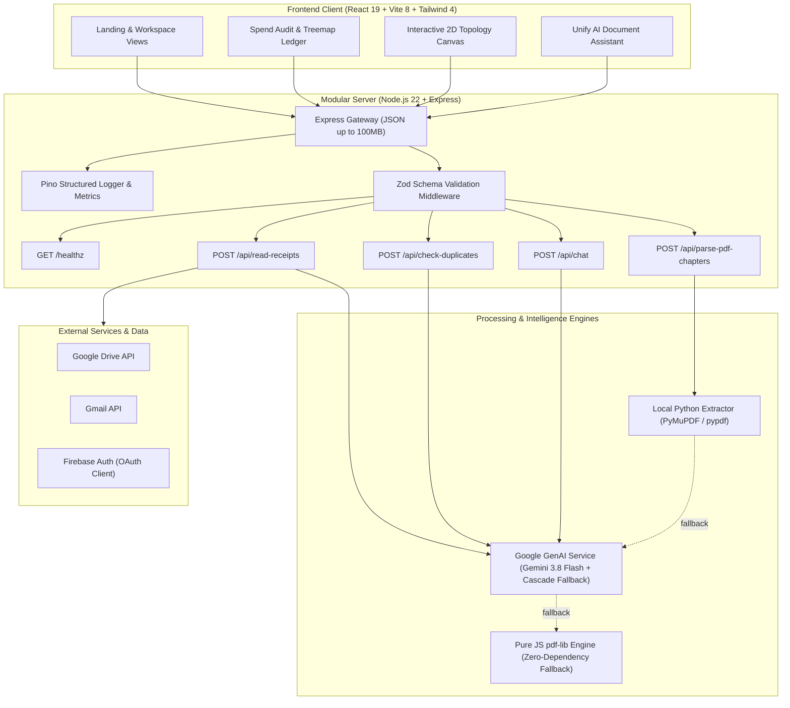

# Openedup — Spend Audit & Document Intelligence Platform

[](https://github.com/Lokeshgandreddy81/OpenedUP/actions/workflows/ci.yml)
[](https://github.com/Lokeshgandreddy81/OpenedUP/actions/workflows/security.yml)
[](https://www.typescriptlang.org/)
[](https://nodejs.org/)
[](LICENSE)
[](SECURITY.md)

Enterprise document intelligence and spend reconciliation platform designed for multi-source receipt auditing, PDF structural decomposition, and automated B2B expense verification.

---

## Architecture Overview

For provider selection, BYOK credential storage, and chat session behavior, see [Chat architecture](docs/chat-architecture.md). The current HTTP contract is maintained in [OpenAPI](docs/api/openapi.yaml).



---

## Monorepo Layout

The two application roots are `frontend/` and `backend/`. Product code lives under those roots; runtime-neutral API contracts are a workspace package at `backend/contracts/` so the frontend does not depend on backend runtime modules.

```text
.
├── frontend/                       # React + Vite browser application
│   ├── src/app/                    # Shell, routing, auth and shared integrations
│   ├── src/features/               # Feature-owned pages, UI, state, services and data
│   │   ├── chapters/               # Intake, document and results screens
│   │   ├── artifacts/              # Artifact screen and persistence client
│   │   ├── benchmarks/             # Benchmarks, image arena and coding-agent screens
│   │   ├── chat/                   # Chat screen, session UI and chat orchestration
│   │   ├── customize/              # Provider/model settings and key client
│   │   ├── plugins/                # Plugin catalog and install state
│   │   ├── projects/               # Projects, sessions and file context
│   │   ├── roadmaps/               # Roadmap screens, renderer and catalog data
│   │   └── scheduled/              # Scheduled task screens and UI
│   ├── src/test/                   # Frontend tests
│   ├── tests/e2e/                  # Playwright browser tests
│   └── infra/docker/               # Frontend Nginx configuration
├── backend/                        # Single-process modular Express application
│   ├── contracts/                  # Runtime-neutral schemas, types and helpers
│   ├── src/app.ts                  # Middleware and domain composition root
│   ├── src/domains/                # HTTP, application, provider and repository modules
│   ├── src/platform/               # Auth, config, database, HTTP and observability
│   ├── tests/                      # Backend unit and integration tests
│   └── scripts/                    # Standalone PDF utilities
├── docs/                           # Architecture decisions and OpenAPI contract
├── specs/                          # Active implementation plans
├── .github/                        # CI and repository configuration
├── docker-compose.yml              # Local multi-container orchestration
└── package.json                    # npm workspace orchestration
```

Each route/screen belongs to one feature and has its own `.tsx` page entry. Feature internals should be imported through that feature's public `index.ts` or explicitly named `publicApi.ts` when another feature needs them. Roadmap and benchmark catalogs remain data modules. The backend remains one deployable process with internal domain boundaries; these folders are not microservices.
---

## Quickstart

### Prerequisites

- **Node.js**: `v22.14.0+` (LTS recommended, see `.nvmrc`)
- **npm**: `v10.9.0+`
- **Python**: `3.9+` (for local standalone PDF chapter extraction)

### Installation

Clone the repository and run deterministic installation:

```bash
git clone git@github.com:Lokeshgandreddy81/OpenedUP.git
cd OpenedUP
npm ci
```

### Environment Configuration

Copy the example environment configuration into the application directory:

```bash
cp backend/.env.example backend/.env
cp frontend/.env.example frontend/.env
```

| Variable           | Required | Default | Description                                                                      |
| :----------------- | :------- | :------ | :------------------------------------------------------------------------------- |
| `GEMINI_API_KEY`   | Optional | None    | Gemini API Key. If omitted, PDF extraction runs 100% locally via Python/pdf-lib. |
| `PORT`             | Optional | `3000`  | HTTP port for the API and static asset server.                                   |
| `GOOGLE_CLIENT_ID` | Optional | None    | OAuth 2.0 client ID for Google Drive and Gmail live synchronization.             |

---

## Available Scripts

Run all scripts from the repository root:

| Command                                                              | Action                                                                      |
| :------------------------------------------------------------------- | :-------------------------------------------------------------------------- |
| `npm run dev`                                                        | Boots application in development mode with live Vite HMR.                   |
| `npm run build`                                                      | Compiles frontend assets with Vite and compiles server bundle with esbuild. |
| `npm start --workspace=@charan-interiors/expense-receipts-analytics` | Runs production server (`node dist/server.js`).                             |
| `npm test`                                                           | Executes complete Vitest suite across all unit & API tests.                 |
| `npm run test:coverage`                                              | Generates detailed V8 code coverage report.                                 |
| `npm run typecheck`                                                  | Validates strict TypeScript types with 0 emit across all workspaces.        |
| `npm run lint`                                                       | Runs ESLint flat configuration check with zero allowable errors.            |
| `npm run format:check`                                               | Verifies code adherence to Prettier formatting standards.                   |
| `npm run format`                                                     | Auto-formats all code, markdown, YAML, and configuration files.             |
| `npm run e2e`                                                        | Executes Playwright end-to-end smoke test suite against running server.     |
| `npm audit`                                                          | Scans dependency tree for vulnerabilities (0 high/critical allowed).        |

---

## Verification Gates Checklist

Prior to merging any pull request into `main`, all 9 verification gates must pass:

1. :white_check_mark: **Deterministic Install**: `npm ci` completes with zero dependency warnings.
2. :white_check_mark: **Strict Typecheck**: `npm run typecheck` passes with 0 errors.
3. :white_check_mark: **Linter**: `npm run lint` passes with 0 errors.
4. :white_check_mark: **Formatting**: `npm run format:check` passes without discrepancies.
5. :white_check_mark: **Tests**: `npm test` passes 100% of test suites.
6. :white_check_mark: **Build**: `npm run build` generates valid client and server distribution files.
7. :white_check_mark: **Security Audit**: `npm audit` reports 0 vulnerabilities.
8. :white_check_mark: **Secret Scanning**: Gitleaks reports 0 leaked tokens or keys.
9. :white_check_mark: **Clean Tree**: Working tree is clean with zero untracked dev artifacts.

---

## Security

Please report vulnerabilities directly via GitHub Private Vulnerability Reporting or review our [Security Policy](SECURITY.md).

## Contributing

Review the [Contributing Guidelines](CONTRIBUTING.md) and [Code of Conduct](CODE_OF_CONDUCT.md) before submitting contributions.

## License

Distributed under the [MIT License](LICENSE). Copyright (c) 2026 Charan Interiors / Openedup Contributors.
