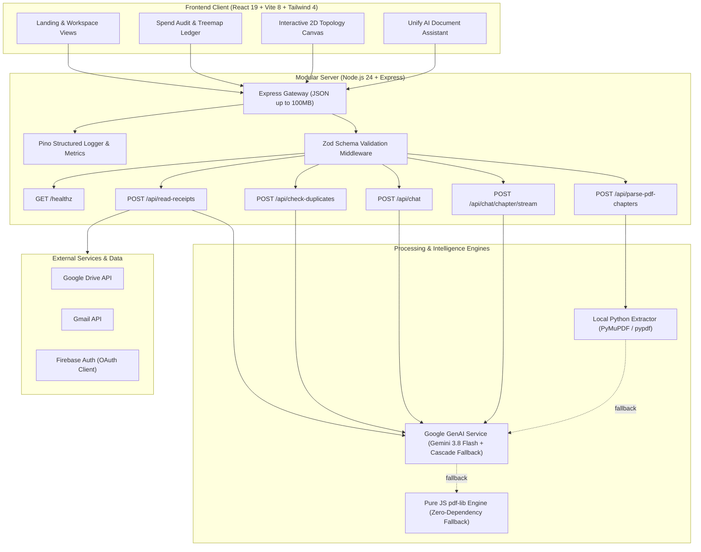

# Openedup — Spend Audit & Document Intelligence Platform

[](https://github.com/Lokeshgandreddy81/OpenedUP/actions/workflows/ci.yml)
[](https://github.com/Lokeshgandreddy81/OpenedUP/actions/workflows/security.yml)
[](https://www.typescriptlang.org/)
[](https://nodejs.org/)
[](LICENSE)

Document intelligence, spend reconciliation, and AI chat platform for receipt auditing, PDF analysis, and conversational workflows.

---

## Architecture Overview

The current HTTP API contract is maintained in [OpenAPI](packages/docs/api/openapi.yaml). Chat sessions use client-selected BYOK keys encrypted with AES-256-GCM at rest, with zero fallback to server environment secrets.



---

## Monorepo Layout

The repository is structured into four focused top-level directories:

```text
.
├── frontend/                       # React 19 + Vite browser application
│   ├── src/app/                    # Shell, routing, auth and shared integrations
│   ├── src/features/               # Feature-owned pages, UI, state, services and data
│   │   ├── artifacts/              # Artifact screen and persistence client
│   │   ├── benchmarks/             # Benchmarks, image arena and coding-agent screens
│   │   ├── chapters/               # Intake, document and results screens
│   │   ├── chat/                   # Chat screen, session UI and chat orchestration
│   │   ├── customize/              # Provider/model settings and key client
│   │   ├── plugins/                # Plugin catalog and install state
│   │   ├── projects/               # Projects, sessions and file context
│   │   ├── roadmaps/               # Roadmap screens, renderer and catalog data
│   │   └── scheduled/              # Scheduled task screens and UI
│   ├── src/test/                   # Frontend unit and component tests
│   ├── tests/e2e/                  # Playwright browser tests
│   └── infra/docker/               # Frontend Nginx configuration
├── backend/                        # Single-process modular Express application
│   ├── src/app.ts                  # Middleware and domain composition root
│   ├── src/domains/                # HTTP, application, provider and repository modules
│   ├── src/platform/               # Auth, config, database, HTTP and observability
│   └── tests/                      # Backend unit and integration tests
├── python/                         # Scalable Python document processing and chunking
│   ├── src/                        # PDF chapter extractor & roadmap generator
│   ├── pyproject.toml              # Ruff configuration
│   └── requirements.txt            # Python dependencies
├── packages/                       # Shared packages, configurations and documentation
│   ├── contracts/                  # Runtime-neutral schemas, types and helpers
│   └── docs/                       # Architecture decisions and OpenAPI contract
├── .github/                        # CI and repository configuration
├── docker-compose.yml              # Local multi-container orchestration
└── package.json                    # npm workspace orchestration
```

Each route/screen belongs to one feature and has its own `.tsx` page entry. Shared API schemas and models are defined in `@charan-interiors/contracts` (`packages/contracts/`) so that the frontend remains decoupled from backend runtime code.
---

## Quickstart

### Prerequisites

- **Node.js**: `v24.12.0+` (see `.nvmrc`)
- **npm**: `v10.9.0+`
- **Python**: `3.9+` (for local standalone PDF chapter extraction)

### Installation

Use Node.js `24.12.0` or newer and npm `10` or newer. The repository pins the tested Node version in `.nvmrc`; npm rejects versions outside the declared engine range. Then clone and install:

```bash
git clone git@github.com:Lokeshgandreddy81/OpenedUP.git
cd OpenedUP
npm ci
```

### Local Development

No environment file is required to start the app locally. Run both services from the repository root:

```bash
npm run dev
```

Open <http://localhost:5173>. Vite proxies `/api` requests to the backend at `http://localhost:3000`. Chat requires a key for the selected provider, entered in the app. To enable server-side Gemini processing for scanned PDFs and images, copy `backend/.env.example` to `backend/.env` and set `GEMINI_API_KEY`; it is optional for startup and ordinary BYOK chat. `frontend/.env.example` is only needed if you want to override the Vite API proxy target.

### Docker Compose

Compose uses the root `.env` file (separate from `backend/.env`):

```bash
cp .env.example .env
docker compose up --build
```

Open <http://localhost:8080>. Before using signed-in credential storage, set `FIREBASE_PROJECT_ID` to match `frontend/firebase-applet-config.json` and set a stable, randomly generated, base64-encoded 32-byte `BYOK_ENCRYPTION_KEY` in `.env`. `GEMINI_API_KEY` is optional and enables server-side Gemini document processing. Keep the `openedup-data` volume to preserve stored account data. Do not commit populated `.env` files.

| Variable              | Required                  | Description                                                                                               |
| :-------------------- | :------------------------ | :-------------------------------------------------------------------------------------------------------- |
| `GEMINI_API_KEY`      | Optional                  | Server key for Gemini-powered scanned document processing. Chat uses the provider key entered in the app. |
| `PORT`                | Optional                  | Backend HTTP port; defaults to `3000`.                                                                    |
| `FIREBASE_PROJECT_ID` | Optional                  | Firebase project used to verify signed-in users and protect saved provider keys.                          |
| `BYOK_ENCRYPTION_KEY` | For saved keys in Compose | Base64-encoded 32-byte key used to encrypt saved provider credentials.                                    |

---

## Available Scripts

Run all scripts from the repository root:

| Command                 | Action                                                                      |
| :---------------------- | :-------------------------------------------------------------------------- |
| `npm run dev`           | Boots application in development mode with live Vite HMR.                   |
| `npm run build`         | Compiles frontend assets with Vite and compiles server bundle with esbuild. |
| `npm start`             | Builds the workspaces and starts the production API server.                 |
| `npm test`              | Executes complete Vitest suite across all unit & API tests.                 |
| `npm run test:coverage` | Generates detailed V8 code coverage report.                                 |
| `npm run typecheck`     | Validates strict TypeScript types with 0 emit across all workspaces.        |
| `npm run lint`          | Runs ESLint flat configuration check with zero allowable errors.            |
| `npm run format:check`  | Verifies code adherence to Prettier formatting standards.                   |
| `npm run format`        | Auto-formats all code, markdown, YAML, and configuration files.             |
| `npm run e2e`           | Builds and starts the production server for the Playwright smoke tests.     |
| `npm audit`             | Scans dependency tree for vulnerabilities (0 high/critical allowed).        |

---

## Verification

CI runs formatting, typechecking, feature-boundary checks, lint, coverage tests, builds, and browser smoke tests on the supported Node versions. The security workflow scans for secrets and dependency vulnerabilities. Run the same checks locally before opening a pull request:

```bash
npm ci
npm run format:check
npm run typecheck
npm run check:feature-boundaries
npm run lint
npm run test:coverage
npm run build
npm audit --audit-level=high
```

---

## Security

Please report vulnerabilities directly via GitHub Private Vulnerability Reporting on the repository page.

## License

Distributed under the [MIT License](LICENSE). Copyright (c) 2026 Charan Interiors / Openedup Contributors.
