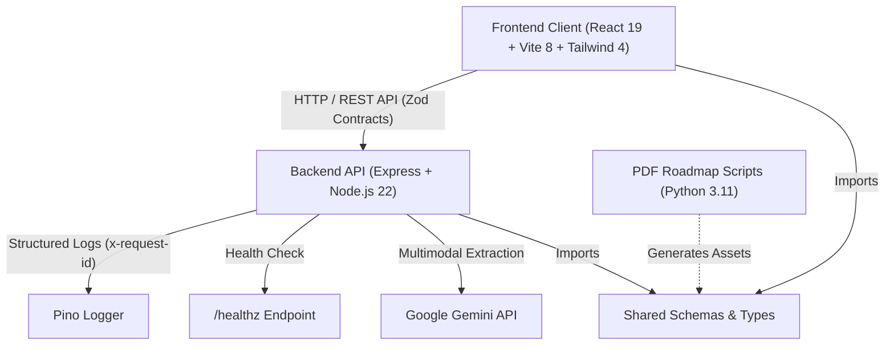

# Charan Interiors & OpenedUp Monorepo

[](.github/workflows/ci.yml)
[](.github/workflows/security.yml)
[](LICENSE)
[](.nvmrc)
[](tsconfig.json)
[](.prettierrc.json)

Enterprise monorepo housing the **Expense & Receipts Analytics** suite, automated receipt ingestion pipelines, and the **OpenedUp Frontier AI Benchmark Observatory**.

---

## Quickstart

### Prerequisites

- **Node.js**: `>= 20.0.0` (Recommended: Node 22 LTS via `.nvmrc`)
- **npm**: `>= 10.0.0`
- **Python**: `>= 3.11` (for PDF chapter and roadmap extraction scripts)

### Installation

Clone the repository and install dependencies using deterministic clean install:

```bash
git clone https://github.com/Charan-Interiors/journal.git
cd journal
npm ci
```

### Local Development

1. **Configure Environment Variables**:
   Copy `.env.example` to `.env` in the root and set your Gemini API key:

   ```bash
   cp .env.example .env
   ```

2. **Launch Development Server**:
   ```bash
   npm run dev
   ```
   Access the client interface at `http://localhost:5173` and backend API endpoints at `http://localhost:3000`.

### Production Build & Verification

```bash
# Verify static TypeScript types
npm run typecheck

# Check code formatting and linting
npm run format:check
npm run lint

# Run unit tests and generate coverage report
npm run test:coverage

# Compile production bundle for client and server
npm run build
```

---

## Architecture

The repository is organized as a clean enterprise monorepo using npm workspaces, adhering to strict architectural boundaries between client presentation, backend business logic, shared contracts, and documentation.



### Monorepo Structure

```
.
├── .github/                 # GitHub Actions CI/CD, security audit, dependabot
├── apps/                    # Primary application workspaces
│   └── expense-receipts-analytics/ # Full-stack receipt & benchmark platform
├── frontend/                # Decoupled React 19 single-page application
├── backend/                 # Decoupled Express API microservice
├── packages/                # Reusable domain packages
│   └── shared/              # Shared TypeScript types and Zod schemas
├── docs/                    # Architecture documentation & standards
│   ├── adr/                 # Architecture Decision Records
│   ├── branch-protection.md # Branch protection and merge policies
│   └── REPO_STANDARDS_PROMPT.md # Enterprise repository guidelines
├── scripts/                 # Ingestion tooling & Python extraction helpers
├── .editorconfig            # Universal editor formatting rules
├── .nvmrc                   # Target Node.js runtime version (22)
├── CHANGELOG.md             # Semantic release history (Changesets)
├── CONTRIBUTING.md          # Developer onboarding & PR standards
├── LICENSE                  # MIT License
└── package.json             # Root monorepo workspace manifest
```

---

## Environment Variables

The table below outlines all environment variables utilized across the monorepo:

| Variable                | Scope    | Type      | Default       | Required | Description                                                    |
| :---------------------- | :------- | :-------- | :------------ | :------- | :------------------------------------------------------------- |
| `PORT`                  | Backend  | `number`  | `3000`        | No       | Port the Express HTTP server listens on                        |
| `HOST`                  | Backend  | `string`  | `0.0.0.0`     | No       | Network interface binding                                      |
| `NODE_ENV`              | Global   | `string`  | `development` | No       | Runtime environment (`development`, `production`, `test`)      |
| `LOG_LEVEL`             | Backend  | `string`  | `info`        | No       | Pino logging level (`trace`, `debug`, `info`, `warn`, `error`) |
| `GEMINI_API_KEY`        | Backend  | `string`  | —             | **Yes**  | API key for Google Gemini multimodal LLM inference             |
| `CORS_ORIGIN`           | Backend  | `string`  | `*`           | No       | Permitted CORS origins (comma-separated domains in production) |
| `VITE_API_BASE_URL`     | Frontend | `string`  | `/api`        | No       | Base URL for frontend API calls                                |
| `VITE_ENABLE_MOCK_DATA` | Frontend | `boolean` | `false`       | No       | Toggle offline mock data fallback in frontend views            |

---

## Monorepo Scripts

Run all scripts from the repository root:

| Script                  | Command                                                                | Purpose                                                |
| :---------------------- | :--------------------------------------------------------------------- | :----------------------------------------------------- |
| `npm run dev`           | `npm run --workspace=@charan-interiors/expense-receipts-analytics dev` | Starts the application in local development mode       |
| `npm run build`         | `npm run --workspaces --if-present build`                              | Compiles client and server bundles across all packages |
| `npm test`              | `npm run --workspaces --if-present test`                               | Executes Vitest unit and integration test suites       |
| `npm run test:coverage` | `npm run --workspaces --if-present test:coverage`                      | Runs tests and generates v8 coverage metrics           |
| `npm run typecheck`     | `npm run --workspaces --if-present typecheck`                          | Performs strict TypeScript type checks with zero emit  |
| `npm run lint`          | `npm run --workspaces --if-present lint`                               | Runs ESLint flat configuration across all packages     |
| `npm run format`        | `prettier --write "**/*.{ts,tsx,js,jsx,json,md,yml,yaml}"`             | Formats all files according to Prettier standards      |
| `npm run format:check`  | `prettier --check "**/*.{ts,tsx,js,jsx,json,md,yml,yaml}"`             | Enforces formatting compliance in CI pipelines         |
| `npm run e2e`           | `npm run --workspace=@charan-interiors/expense-receipts-analytics e2e` | Runs Playwright end-to-end browser integration tests   |

---

## Architectural Decisions & Standards

We document major structural and infrastructural changes using Architecture Decision Records:

- [ADR 0000: Architecture Decision Record Process & Template](docs/adr/0000-adr-template.md)
- [ADR 0001: Decouple Monolithic Server into Distinct Frontend and Backend](docs/adr/0001-frontend-backend-split.md)

For branch protection, CI requirements, and PR review protocols, review [docs/branch-protection.md](docs/branch-protection.md).

---

## Security & Contributions

- **Security**: Review our vulnerability reporting policy in [SECURITY.md](SECURITY.md).
- **Contributing**: Please read our [CONTRIBUTING.md](CONTRIBUTING.md) guide and adhere to the [CODE_OF_CONDUCT.md](CODE_OF_CONDUCT.md).

---

## License

This repository is licensed under the [MIT License](LICENSE).
