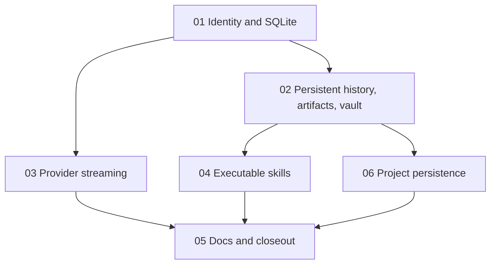

# Chat product gaps

## Next Agent Prompt

This spec records the chat product-gap implementation and its remaining external verification. Preserve the accepted decisions below when continuing. Keep anonymous chat available as transient BYOK chat.

**Status (2026-10-23):** slices 01–06 and the listed product changes are implemented in the working tree. Automated checks pass: 149 frontend, 112 backend, and 15 contract tests; typecheck, production build, and seven Playwright E2E checks pass. Project local-to-account migration, server authority, project CRUD/search/sort, session streaming/cancellation, bounded file extraction, artifact editing/history/export, browser speech recovery, and retry after a failed stream are covered in code. A Gemini key has reached the provider from the local UI; live quota behavior and broad real-provider coverage, authenticated account migration/sharing, and physical microphone/browser speech behavior remain unverified. See the checklist below.

**Next Agent Prompt:** Continue only the external verification items below when provider credentials, two authenticated Firebase accounts, and supported browser microphone access are available. Do not claim live provider, account, microphone, or deployment verification without exercising those exact paths.

**Warnings:** Firebase web config is in `frontend/firebase-applet-config.json`; backend deployments must be given the matching `FIREBASE_PROJECT_ID`. SQLite is a single-instance persistence store; production container data must be mounted persistently. Never accept a user ID from request data as identity.

**Global TODO:**

- [x] [Slice 01](slices/01-identity-and-storage.md): verified identity, SQLite repositories, owner-scoped APIs, Docker persistence.
- [x] [Slice 02](slices/02-history-artifacts-and-vault.md): persistent conversations, shared authenticated artifacts, idempotent local artifact import, explicit BYOK vault saving.
- [x] [Slice 03](slices/03-provider-streaming.md): true provider token streaming, SSE cancellation, frontend incremental rendering.
- [x] [Slice 04](slices/04-executable-skills.md): versioned skill catalog and bounded context execution from chat.
- [x] [Slice 05](slices/05-docs-and-closeout.md): OpenAPI, architecture docs, full automated verification, and independent code review.

## Goal and accepted product decisions

Close the gaps called out in the audit:

1. Chat history must survive refresh/relogin and be scoped to the signed-in user.
2. Artifacts must persist to the signed-in user and “Shared” must mean visible to authenticated users only. Owners can revoke sharing.
3. Existing browser-local artifacts must be imported once after sign-in, idempotently. Preserve legacy `isShared` as shared only with signed-in users; anonymous users never see shared records.
4. Skills must execute registered, bounded backend capabilities. No model-supplied code, arbitrary filesystem access, or implicit mutation.
5. The chat SSE route must forward provider deltas as they arrive and cancel upstream work on client disconnect.
6. Provider keys must leave persistent browser storage. Persist saved BYOK credentials in a per-user server vault encrypted with AES-256-GCM; never return key material. Allow explicit one-request ephemeral BYOK where vault setup is unavailable.

Anonymous chat remains usable as a non-persisted session. Temporary chats stay temporary. The current UI has no historical conversation data to import; its conversations are transient. Only existing artifacts need import.

## Follow-up product checklist

- [ ] Verify saved-key verification and real chat requests for each provider/model family; test invalid keys, rate limits, timeouts, retry behavior, and actionable recovery text. Requires provider credentials; deterministic provider adapter tests pass locally.
- [x] Confirm implemented model/effort/output-limit capability mapping and custom-provider routing in main and project request paths. Local endpoint support remains deliberately excluded by HTTPS/public-address SSRF protections; revisit only with an explicit safe local-network design.
- [ ] Run live streaming against each provider with real credentials. Deterministic OpenAI-compatible, Anthropic, and Gemini stream, cancellation, and partial-error fixtures pass locally.
- [ ] Exercise microphone permission, speech recognition failure/unsupported states, transcript editing, synthesis interruption, and recovery in supported browsers. UI recovery paths are implemented; physical microphone and browser speech service verification remains open.
- [x] Implement owner artifact edit/rename/export/version restore history and visible loading/empty/sync/save/delete/share error states. Real signed-in save/reopen and cross-account sharing still need account-backed verification.
- [x] Audit project create/rename/delete/session/search/sort behavior and account-scoped persistence contract. Browser-local CRUD/search/sort and server/local migration paths are implemented; actual signed-in reload/migration still needs account-backed verification. File extraction and limits are enforced by the project file path.
- [x] [Slice 06](slices/06-project-persistence.md): account-scoped project persistence, local import, and project/session data ownership.
- [x] Replace the Plugins shell with a first-party allowlisted catalog, working search/categories, browser-local install/uninstall, and explicit capability permissions. Third-party plugin install/execution remains out of scope until its trust and credential model is designed; never execute arbitrary plugin JavaScript.
- [x] V1 skills are the three bundled server-owned capabilities; arbitrary custom/installable skills remain out of scope until their trust and permission model is designed. Tests verify selected-skill effects, matching/irrelevant/missing context, and bounded traces.
- [x] Check mobile and keyboard access for chat, artifacts, projects, and provider settings; full automated checks pass. Physical-device/accessibility audit remains a separate release check.
- [ ] Keep live-provider, real-account, microphone, and deployment checks clearly separated from automated local evidence.

## Product decisions carried into slice 06

- Projects remain available as browser-local data while signed out; signing in migrates the current browser snapshot to the first account that claims it, then the server becomes authoritative for that account.
- The demo project is a presentation fixture, not user data, and is excluded from import.
- Project session messages belong to the project snapshot. The previous duplicate write to general conversations is removed for new project sessions.
- Project snapshots use bounded JSON storage in SQLite to match the existing whole-project UI mutations. Multi-tab conflict merge is not promised; last completed save per project snapshot wins.

## Architecture ownership

- `backend/src/middleware/firebaseAuth.ts` verifies Firebase ID tokens and sets an immutable `Principal` from the verified `sub`/UID claim.
- `backend/src/db/chatDatabase.ts` owns SQLite schema and the single database handle. `backend/src/repositories/` owns persistence queries; services own domain behavior.
- Shared Zod schemas own wire contracts. Request bodies never own identity or ownership decisions.
- Frontend `chatAuth` owns Firebase chat sign-in, auth state, and ID-token retrieval. API helpers attach tokens; views do not build auth headers themselves.
- `backend/src/services/llm.service.ts` owns provider streaming adapters. The controller translates provider deltas to SSE.
- `backend/src/services/skillRegistry.ts` owns versioned skills and their bounded context actions. Skill IDs are schema-validated and skill text is never interpreted as code.

## Slice graph and review surface

Review with two Firebase-authenticated accounts in separate browser profiles: create and reload conversations; create a private artifact; share it and verify the second account can read it; revoke and verify denial; import the first account’s old local artifact list once; confirm malformed/expired identity is rejected. Then run a delayed mock provider and verify the first SSE delta arrives before provider completion and disconnect cancels the source. Finally invoke each skill through a mocked tool-call exchange and verify schema, permission, timeout, and call-count limits.

## Contracts and firewalls

- Every persistent chat/artifact/credential query is scoped by `principal.uid` in SQL predicates.
- Only Firebase ID tokens from the configured Firebase project authenticate. Google Workspace OAuth access tokens are not accepted as app identity.
- Shared artifact access is read-only for non-owners. Only the owner may update, delete, or toggle sharing.
- SQLite is deliberately single-instance. Do not claim horizontal multi-instance durability; replacing storage requires implementing the repository seam.
- BYOK vault encryption key is supplied as `BYOK_ENCRYPTION_KEY` (base64 for exactly 32 bytes) in hosted deployment. Dev may create a mode-0600 local key file outside the repo. No browser encryption claims.
- Client-side API-key migration reads the previous localStorage key once into ephemeral memory, removes the local copy, and offers explicit save-to-vault; do not upload keys silently.
- The old local artifact store is retained after import. Import is idempotent by `(uid, legacyArtifactId)`.
- Skills run one bounded pre-inference pass over request-supplied context. They have no shell, network, arbitrary path, provider-credential, or mutation capability; the model cannot invent tool IDs or arguments.
- Provider error details are sanitized before SSE. Partial stream failures emit `error` with `partial: true`; they are never persisted as completed assistant turns.
- Failed streams remove their empty or partial assistant placeholder before the next request is assembled, keeping every submitted conversation message schema-valid.
- Project-file content enters chat only after browser-side extraction from an allowed text format and within the shared context limit; treat it as untrusted prompt data.
- Dictation is a browser feature; typed chat remains available when speech recognition or microphone permission is unavailable.

## Feedback that changes the plan

Only a change to the accepted sharing audience, identity provider, or hosted storage topology changes the core contracts. Cosmetic UI choices and internal repository naming are delegated.

## Release verification still needed

Before deployment, set the matching Firebase project ID and a stable 32-byte `BYOK_ENCRYPTION_KEY`; opt into server-owned provider keys only if intended. With Docker and real Firebase/provider credentials available, verify the compose volume, sign-in, artifact import/sharing across two accounts, provider calls, and streaming cancellation. No live credentials were used during local verification.
